<p align="center">
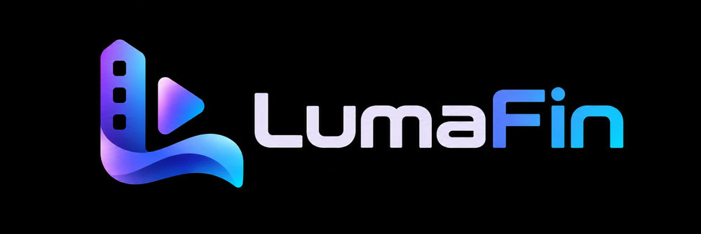
</p>
<h3 align="center">A modified Android TV client for <a href="https://jellyfin.org">Jellyfin</a></h3>

---

<p align="center">
<a href="https://github.com/bagodees/LumaFin-AndroidTV/blob/lumafin-main/LICENSE">

</a>
<a href="https://github.com/bagodees/LumaFin-AndroidTV/releases">

</a>
</p>
<p align="center"><strong>Download and install: <a href="https://getlumafin.com">getlumafin.com</a></strong></p>

LumaFin is a personal fork of [jellyfin-androidtv](https://github.com/jellyfin/jellyfin-androidtv), the official Jellyfin
client for Android TV, Nvidia Shield, and Amazon Fire TV devices. It tracks upstream Jellyfin for bug fixes and new
features while layering on its own branding and home screen customizations, styled after a [JellyFrame](https://jellyfrom.tv/)
webui setup using the "Better Jellyfin UI" theme by tromoSM, the "Rating Badges" mod by grimmdev, and the
[jellyfin-plugin-home-sections](https://github.com/IAmParadox27/jellyfin-plugin-home-sections) plugin by IAmParadox27.

LumaFin for Android phones, foldables and tablets is a separate app in its own repository,
[LumaFin-Android](https://github.com/bagodees/LumaFin-Android).

This is not an officially supported Jellyfin project - it's built for personal use and shared as-is. See
[LICENSE](LICENSE) for license details, and the upstream project at
[jellyfin/jellyfin-androidtv](https://github.com/jellyfin/jellyfin-androidtv) for the official Android TV client.

## Screenshots

### Home screen

<p align="center">
  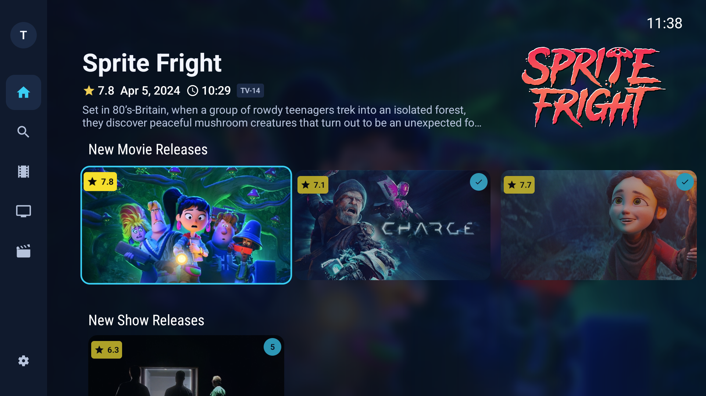
</p>

### Details screens

| Movie details | Episode details |
| --- | --- |
| 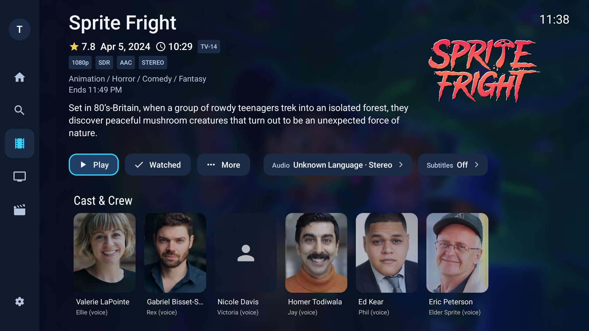 | 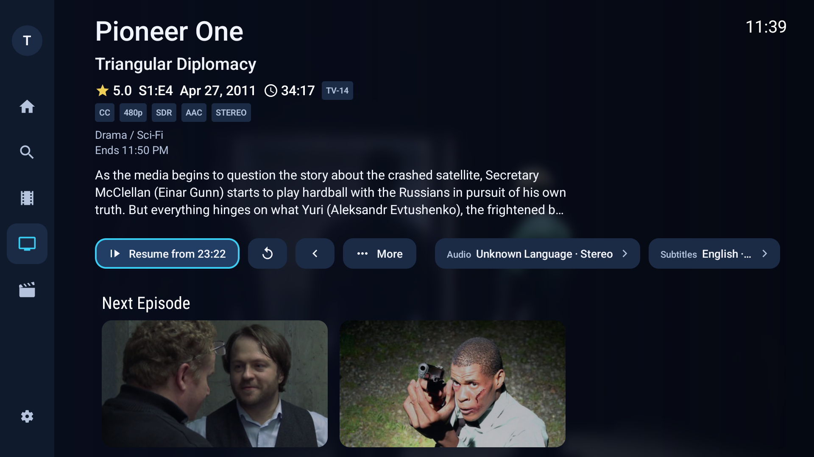 |

### Request movies and shows

With the SeerrFin plugin on your server, Home shows what's trending and coming soon, and every title opens its own page.

| Trending and upcoming | Title page |
| --- | --- |
| 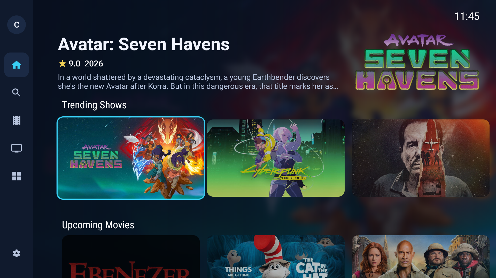 | 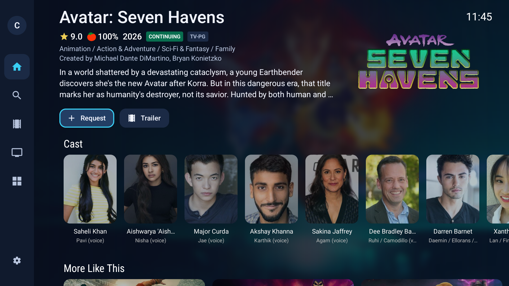 |

### Playback

| Player controls | Player menus |
| --- | --- |
| 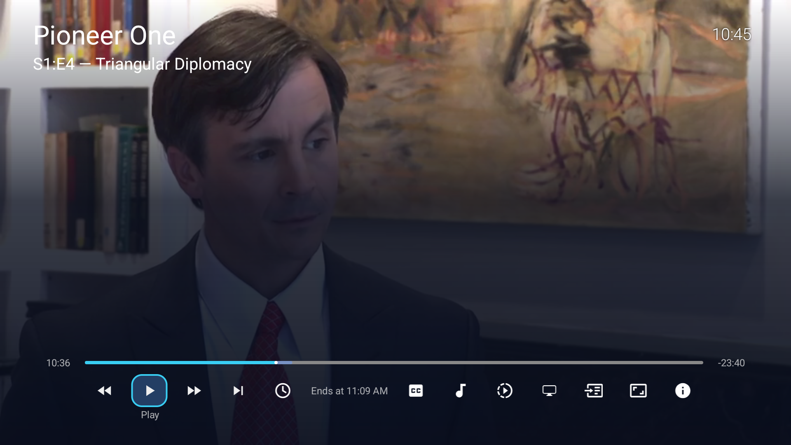 | 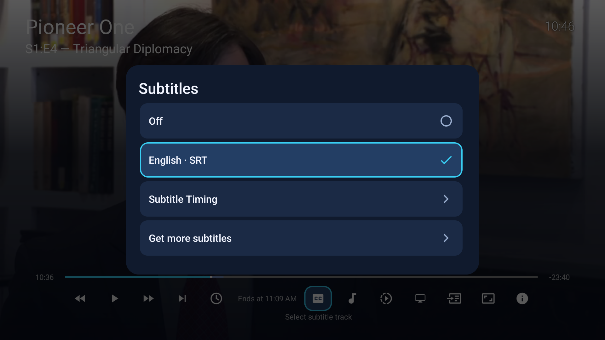 |

### Libraries

| Recommended | Library grid |
| --- | --- |
| 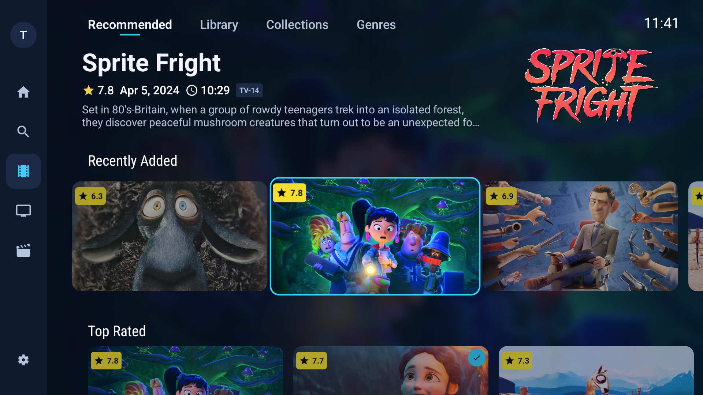 | 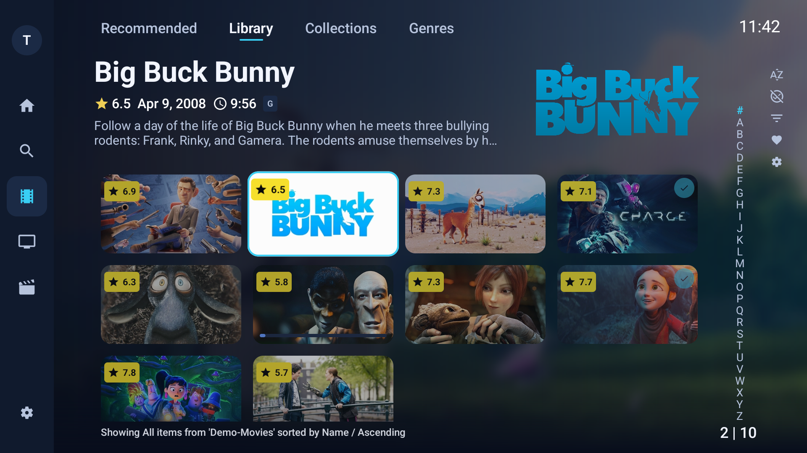 |

| Filters |
| --- |
| 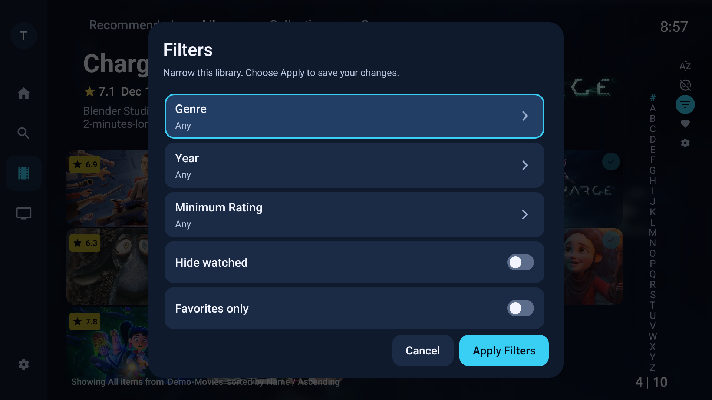 |

### Settings

| Settings | Home rows |
| --- | --- |
| 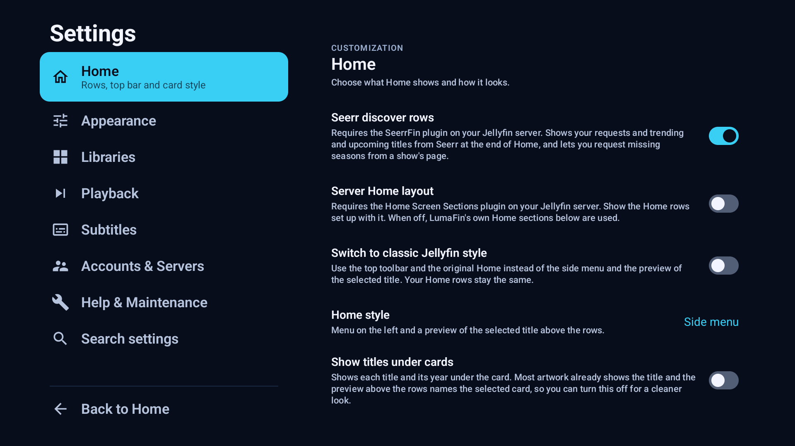 | 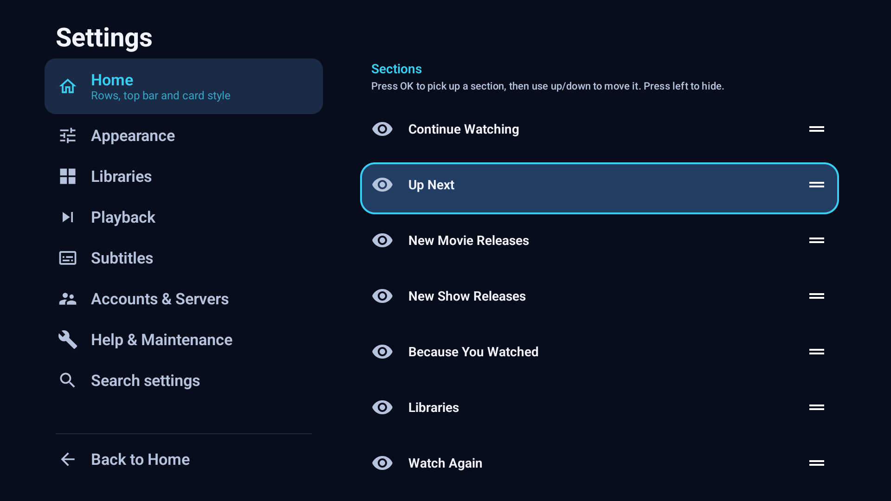 |

### Profiles

<p align="center">
  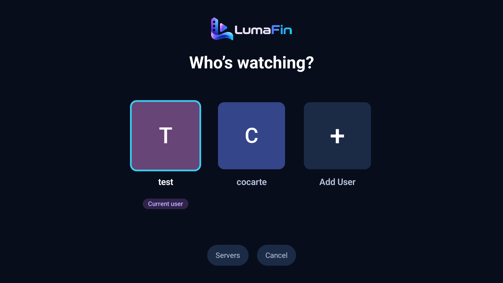
</p>

<sub>Screenshots show Creative Commons films from Blender Studio ([studio.blender.org](https://studio.blender.org/films/)),
CC BY: Elephants Dream, Big Buck Bunny, Sintel, Tears of Steel, Caminandes, Cosmos Laundromat, Agent 327, Spring,
Sprite Fright and Charge; and Pioneer One by Josh Bernhard and Bracey Smith, Creative Commons. Titles in the request
screenshots come from Seerr and TMDB and belong to their owners.</sub>

## What's different from upstream

- **Landscape, thumbnail-first artwork** - content cards throughout the app use a Thumbnail → Backdrop → Primary
  image priority and render as uniform 16:9 tiles, matching the JellyFrame webui look instead of per-type portrait
  posters. Continue Watching and Recently Added correctly show series artwork for TV episodes.
- **Rating badges** - movie and series cards show critic (Rotten Tomatoes-style) and community rating badges,
  matching the webui's grimmdev Rating Badges mod.
- **More home section types** - beyond the built-in sections you can add Latest Movies, Latest Shows, Because You
  Watched, Collections, Watch Again, Genres, Favorites, a combined Continue Watching / Next Up row, and Recently
  Added / Latest rows for movies, shows, albums, artists, music videos, books and audiobooks.
- **Reorderable home settings** - Settings > Customization > Home is a single list of every section. Press OK on a
  shown section to pick it up, move it with up/down and drop it with OK or Back; press left to hide a section, and
  hidden sections wait in a dimmed list below. Changes apply immediately and are stored locally on-device so they
  can't be reverted by a session refresh or another Jellyfin client.
- **Web-style playback controls** - seek bar with elapsed and remaining time, chapter tick marks, a single controls
  row with the focused button's name, and secondary controls (subtitles, audio, chapters, speed, quality, zoom) on
  the right.
- **Richer episode and movie details** - artwork on the left, series name above the episode title, runtime, genres,
  director and end time in the header, Favorite kept on the button row, and audio and subtitle pickers that apply
  when you press Play.
- **LumaFin branding** - its own icon, Android TV banner, splash screen, and accent color theme, with its own
  application ID so it can be installed alongside the official Jellyfin app.

## Installing

- **Google TV, Android TV and Nvidia Shield:** install from Google Play by joining the beta at
  **[getlumafin.com/beta](https://getlumafin.com/beta)**. Play keeps LumaFin updated automatically.
- **Amazon Fire TV:** Fire TV doesn't have Google Play, so install the APK. In the free Downloader app, enter
  `getlumafin.com/android` to fetch the newest release. Step-by-step instructions are at
  **[getlumafin.com](https://getlumafin.com/#install-firetv)**.

## Building

The app uses Gradle and requires the Android SDK. We recommend using Android Studio, which includes all required
dependencies, for development and building. For manual building without Android Studio make sure a compatible JDK
and Android SDK are installed and in your PATH, then use the Gradle wrapper (`./gradlew`) to build the project with
the `assembleDebug` Gradle task to generate an apk file:

```shell
./gradlew assembleDebug
```

The task will create an APK file in the `/app/build/outputs/apk/debug` directory.

## Roadmap

See the [LumaFin roadmap](ROADMAP.md) for planned milestones and their status.
Google Play distribution is planned for a future release and is currently deferred.

## Support LumaFin

LumaFin is maintained in spare time. If it makes your Jellyfin setup better, you can support ongoing Android TV
improvements, testing, and maintenance through [GitHub Sponsors](https://github.com/sponsors/bagodees). Sponsorship is
entirely optional — LumaFin will remain free and open source.

## Branching

The `lumafin-main` branch is the active development branch and default branch for this fork, carrying all LumaFin
customizations. The `master` branch tracks upstream `jellyfin/jellyfin-androidtv` unmodified, to make pulling in
upstream changes straightforward.
